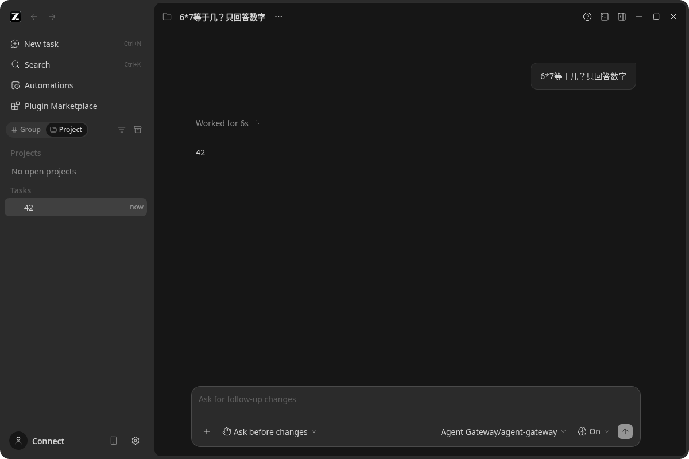
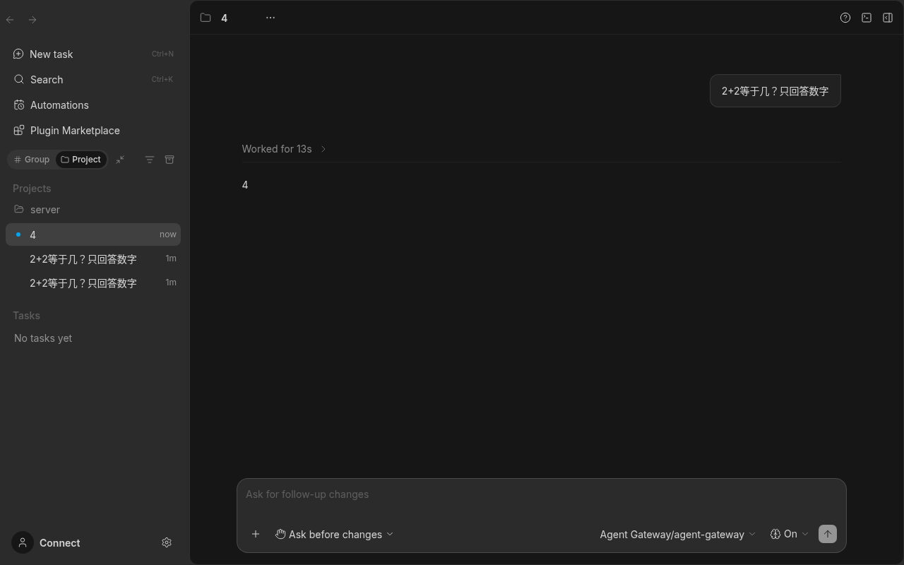

# AgentCore 桌面端

**3.15.1** · 基于 ZCode 前端、可插拔 Agent 后端的跨平台桌面应用，可接入 AgentScope、阿里云 AgentCore、AG-UI 以及 OpenAI 兼容服务。

## 界面截图


*桌面端启动 / Desktop start screen*



*桌面对话回复 / Desktop chat reply*


*Agent 后端设置 / Agent backend settings*



*Web 端对话 / Web chat reply*

## 功能特性

- ZCode（Electron + React）桌面 / Web 共用界面，通过桥接接入多种 Agent 后端。
- 后端插件：mock、AgentScope、阿里云 AgentCore、AG-UI、OpenAI 兼容网关，可按需扩展。
- 内置工具执行（读文件、终端、编辑等）与流式对话、审计/历史记录。
- 配套 `agent-service` Python 网关（可打包为独立可执行文件）。

## 技术栈

- 前端：ZCode（Electron, React, TypeScript）
- 网关：Python / FastAPI（AgentScope 等）
- 包管理：pnpm（ZCode 工作区）

## 从源码运行

源码在 `src/agentcore-desktop/`。本仓库不包含安装包。开发与构建请以该目录下的说明为准：

```bash
cd src/agentcore-desktop
# 详见其中 README：ZCode 前端通常使用 pnpm，Agent 服务使用 Python
```

ZCode 本体在 `src/agentcore-desktop/ZCode/`，产品说明见 `src/agentcore-desktop/README.md`。

## 文档

- [产品说明](src/agentcore-desktop/README.md)
- [ZCode README](src/agentcore-desktop/ZCode/README.md)
- [ZCode README (English)](src/agentcore-desktop/ZCode/README.en.md)
- [AgentScope](src/agentcore-desktop/agentscope/README_zh.md)

## 许可证

ZCode 在 `src/agentcore-desktop/ZCode/package.json` 与 `src/agentcore-desktop/ZCode/LICENSE` 中声明为 Apache-2.0。请同时查看 ZCode 的第三方声明。

---

## English

# AgentCore Desktop

**3.15.1** · A cross-platform desktop app built on the ZCode frontend with pluggable agent backends: AgentScope, Alibaba Cloud AgentCore, AG-UI, and OpenAI-compatible services.

## Screenshots


*桌面端启动 / Desktop start screen*


*桌面对话回复 / Desktop chat reply*


*Agent 后端设置 / Agent backend settings*


*Web 端对话 / Web chat reply*

## Features

- Shared ZCode (Electron + React) UI for desktop and web, bridged to multiple agent backends.
- Backend plugins: mock, AgentScope, Alibaba Cloud AgentCore, AG-UI, and OpenAI-compatible gateways.
- Built-in tool execution (files, shell, edits), streaming chat, and audit/history views.
- Includes an `agent-service` Python gateway that can be packaged as a standalone executable.

## Tech stack

- 前端：ZCode（Electron, React, TypeScript）
- 网关：Python / FastAPI（AgentScope 等）
- 包管理：pnpm（ZCode 工作区）

## Getting started

Source is under `src/agentcore-desktop/`. This repository does not include installers. Follow the in-tree README for development and builds:

```bash
cd src/agentcore-desktop
# See that README: the ZCode UI typically uses pnpm; the agent service uses Python
```

ZCode itself lives in `src/agentcore-desktop/ZCode/`. Product notes are in `src/agentcore-desktop/README.md`.

## Documentation

- [产品说明](src/agentcore-desktop/README.md)
- [ZCode README](src/agentcore-desktop/ZCode/README.md)
- [ZCode README (English)](src/agentcore-desktop/ZCode/README.en.md)
- [AgentScope](src/agentcore-desktop/agentscope/README_zh.md)

## License

ZCode is licensed Apache-2.0 (`src/agentcore-desktop/ZCode/LICENSE` and `package.json`). Also see ZCode third-party notices.

