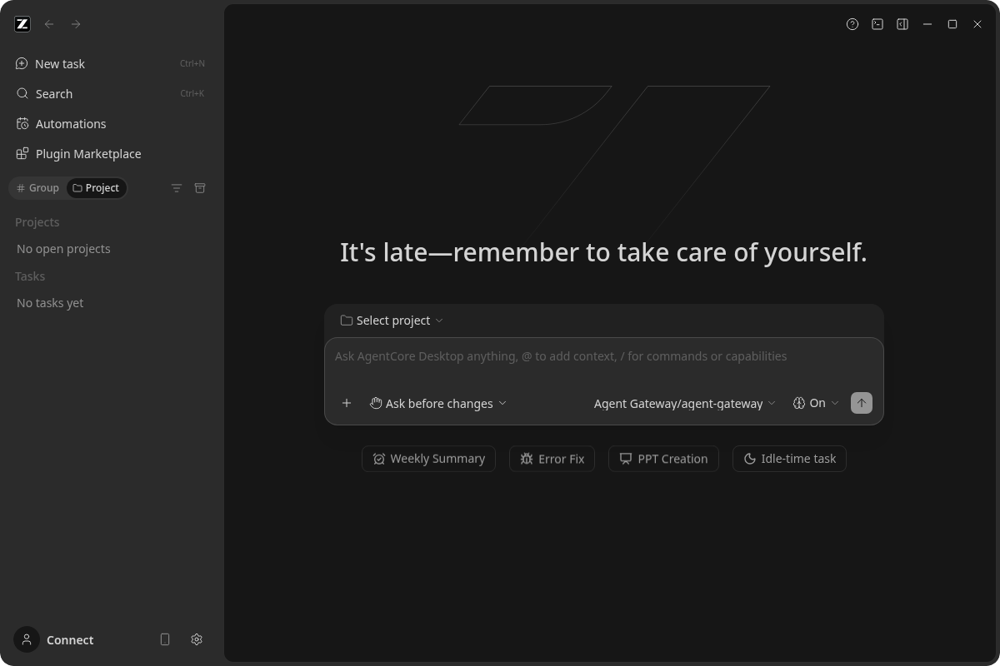
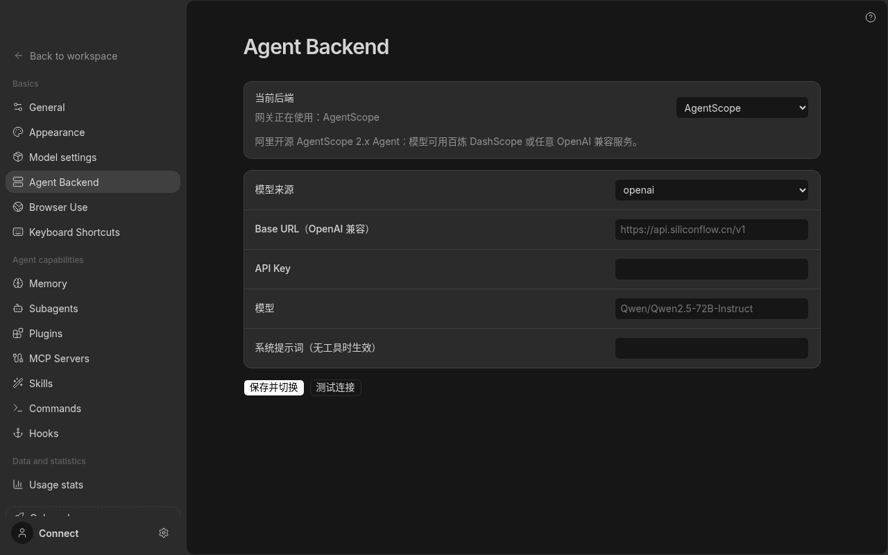

# AgentCore 桌面端

**3.15.1** · 基于 ZCode 前端、可插拔 Agent 后端的跨平台桌面应用，可接入 AgentScope、阿里云 AgentCore、AG-UI 以及 OpenAI 兼容服务。

## 界面截图



*桌面端启动 / Desktop start screen*


*桌面对话回复 / Desktop chat reply*



*Agent 后端设置 / Agent backend settings*


*Web 端对话 / Web chat reply*

## 功能特性

- ZCode（Electron + React）桌面 / Web 共用界面，通过桥接接入多种 Agent 后端。
- 后端插件：mock、AgentScope、阿里云 AgentCore、AG-UI、OpenAI 兼容网关，可按需扩展。
- 内置工具执行（读文件、终端、编辑等）与流式对话、审计/历史记录。
- 配套 `agent-service` Python 网关（可打包为独立可执行文件）。

## 技术栈

- 前端：ZCode（Electron, React, TypeScript）
- 网关：Python / FastAPI（AgentScope 等）
- 包管理：pnpm（ZCode 工作区）

## 从源码运行

源码在仓库根目录。**本仓库不包含安装包，也尚未在本迭代中发布经过验证的 Windows 安装包。** 开发、测试与构建细节见 [docs/开发与构建.md](docs/开发与构建.md) 和 [agent-service/README.md](agent-service/README.md)。

本地复现 CI（无需任何云端 API Key）：

```bash
./scripts/run-tests.sh
```

或：

```bash
cd agent-service
python3 -m venv .venv && source .venv/bin/activate
pip install -r requirements-dev.txt
pytest -q
# 回到仓库根目录后：
node --test tests/product-isolation.test.mjs tests/gateway-supervisor.test.mjs
```

启动本机网关（默认 `127.0.0.1:18765`）：

```bash
cd agent-service
source .venv/bin/activate
python run_gateway.py --host 127.0.0.1 --port 18765
```

密钥放在 `agent-service/.env` 或 `~/.agentcore-desktop/.env`，不要提交。默认应用数据目录是 `~/.agentcore-desktop`，协议是 `agentcore://`，与原版 ZCode 隔离。

ZCode 本体在 `ZCode/`。从源码运行完整桌面还需要 ZCode 工作区的 pnpm 依赖，参见 `ZCode/README.md`。

## 文档

- [ZCode README](ZCode/README.md)
- [ZCode README (English)](ZCode/README.en.md)
- [AgentScope](agentscope/README_zh.md)


## 贡献

欢迎通过 Issue 和 Pull Request 参与，详见 [CONTRIBUTING.md](CONTRIBUTING.md)。安全问题请按 [SECURITY.md](SECURITY.md) 私下报告。参与时请遵守 [CODE_OF_CONDUCT.md](CODE_OF_CONDUCT.md)。

## 许可证

ZCode 在 `ZCode/package.json` 与 `ZCode/LICENSE` 中声明为 Apache-2.0。请同时查看 ZCode 的第三方声明。

---

## English

# AgentCore Desktop

**3.15.1** · A cross-platform desktop app built on the ZCode frontend with pluggable agent backends: AgentScope, Alibaba Cloud AgentCore, AG-UI, and OpenAI-compatible services.

## Screenshots


*桌面端启动 / Desktop start screen*


*桌面对话回复 / Desktop chat reply*


*Agent 后端设置 / Agent backend settings*


*Web 端对话 / Web chat reply*

## Features

- Shared ZCode (Electron + React) UI for desktop and web, bridged to multiple agent backends.
- Backend plugins: mock, AgentScope, Alibaba Cloud AgentCore, AG-UI, and OpenAI-compatible gateways.
- Built-in tool execution (files, shell, edits), streaming chat, and audit/history views.
- Includes an `agent-service` Python gateway that can be packaged as a standalone executable.

## Tech stack

- 前端：ZCode（Electron, React, TypeScript）
- 网关：Python / FastAPI（AgentScope 等）
- 包管理：pnpm（ZCode 工作区）

## Getting started

Source is at the repository root. **This repository does not include installers, and this iteration does not publish a verified Windows setup package.** See [docs/开发与构建.md](docs/开发与构建.md) and [agent-service/README.md](agent-service/README.md).

Reproduce CI locally (no cloud API keys required):

```bash
./scripts/run-tests.sh
```

Start the local gateway on `127.0.0.1:18765`:

```bash
cd agent-service
source .venv/bin/activate
python run_gateway.py --host 127.0.0.1 --port 18765
```

Put secrets in `agent-service/.env` or `~/.agentcore-desktop/.env` and never commit them. Default data lives in `~/.agentcore-desktop` with the `agentcore://` protocol, isolated from stock ZCode.

The ZCode tree is in `ZCode/`. Running the full desktop UI from source also needs the ZCode pnpm workspace; see `ZCode/README.md`.

## Documentation

- [ZCode README](ZCode/README.md)
- [ZCode README (English)](ZCode/README.en.md)
- [AgentScope](agentscope/README_zh.md)


## Contributing

Issues and pull requests are welcome. See [CONTRIBUTING.md](CONTRIBUTING.md). Please report vulnerabilities privately via [SECURITY.md](SECURITY.md). This project follows [CODE_OF_CONDUCT.md](CODE_OF_CONDUCT.md).

## License

ZCode is licensed Apache-2.0 (`ZCode/LICENSE` and `package.json`). Also see ZCode third-party notices.
